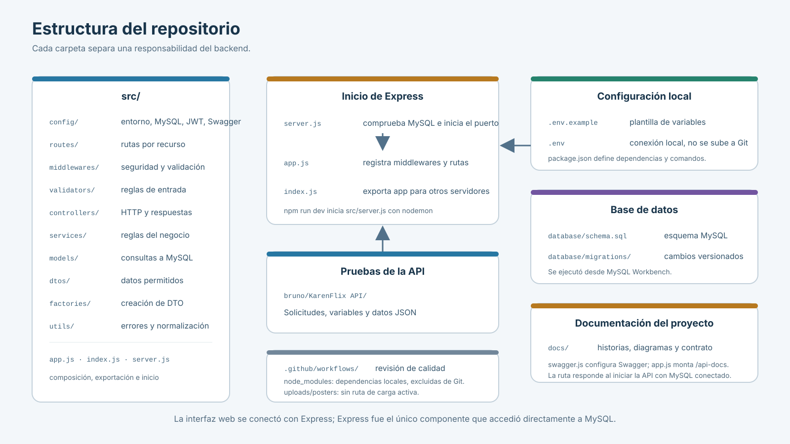

# Arquitectura de KarenFlix, explicada por partes

El mapa completo quedó en `arquitectura-completa.svg`. Para presentarlo con más detalle, se prepararon cinco diagramas cortos. El orden va desde las carpetas del repositorio hasta la conexión con MySQL y los entornos.

## 01. Carpetas del repositorio

En esta primera parte se puede explicar dónde quedó cada responsabilidad: `routes` definió las rutas, `controllers` atendió HTTP, `services` aplicó las reglas del sistema y `models` consultó MySQL. `server.js` inició el servidor y `app.js` reunió la configuración de Express.

## 02. Recorrido de una solicitud

[Abrir diagrama 02](02-flujo-solicitud.svg). Muestra cómo una solicitud pasó por Express, la validación y autenticación, las capas de negocio y MySQL; también muestra el regreso de respuestas y errores.

## 03. Autenticación y sesión

[Abrir diagrama 03](03-autenticacion-sesion.svg). Explica el registro, el inicio de sesión, el JWT, la cookie HttpOnly, los roles y el cierre de sesión.

## 04. Modelo de datos MySQL

[Abrir diagrama 04](04-modelo-mysql.svg). Resume las tablas, claves y relaciones entre usuarios, películas, actores, reseñas, reacciones y favoritos.

## 05. Conexión local y producción

[Abrir diagrama 05](05-conexion-entornos.svg). Compara la conexión local con la configuración requerida en un proveedor de alojamiento. El despliegue todavía debía configurarse con los dominios y credenciales del equipo.
