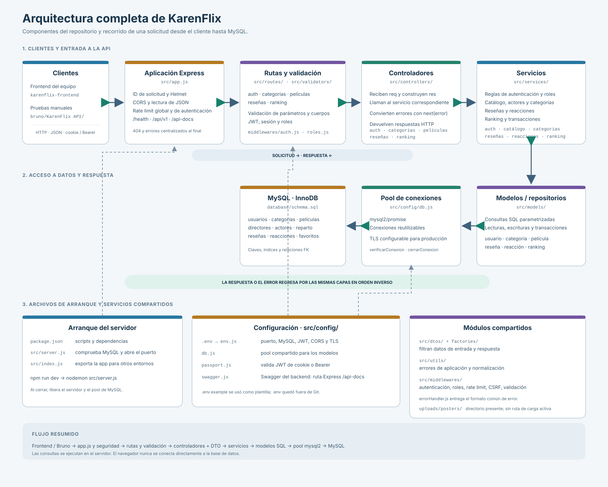

# Arquitectura completa del backend

El diagrama reúne los módulos de `src/`, el arranque de Express, la conexión del frontend y Bruno, y la comunicación con MySQL. Las flechas dobles muestran que las respuestas vuelven por la misma cadena de capas.

La imagen vectorial está en `arquitectura-completa.svg` y puede ampliarse o insertarse en el informe sin perder calidad.
