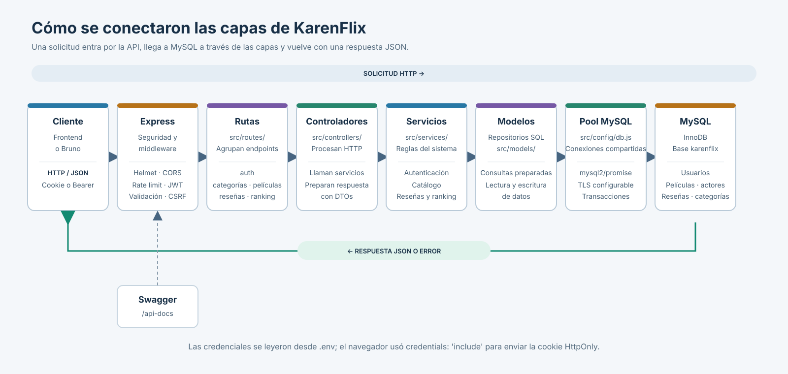

# Capas del backend

La imagen muestra el recorrido de una solicitud desde el frontend o Bruno hasta MySQL y el regreso de la respuesta. Cada carpeta de `src/` corresponde a una parte de ese recorrido.

La fuente del diagrama está guardada en `capas-backend.svg`; se puede insertar en el informe y ampliar sin perder calidad.
